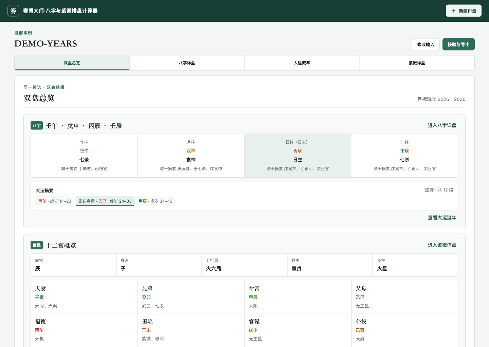
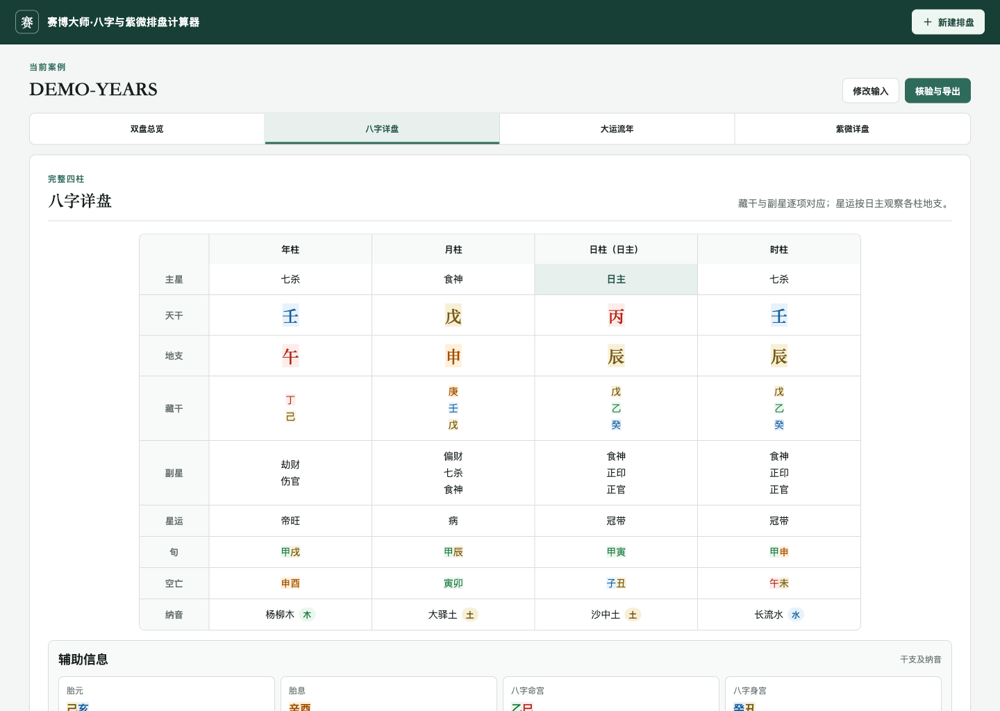
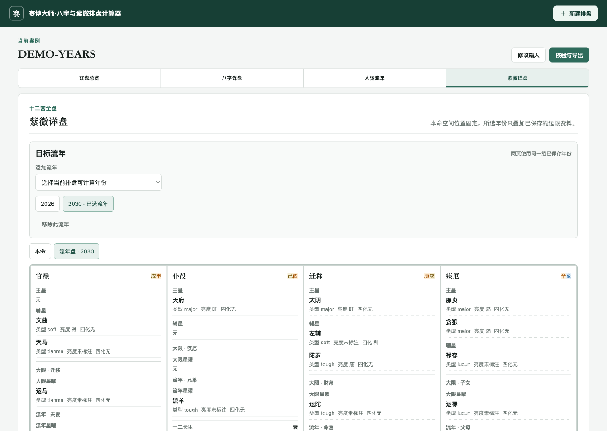

# 赛博大师·八字与紫微斗数排盘计算器

在本机输入出生时间，同时生成八字与紫微斗数排盘，然后一键复制给你选择的 AI。

**v0.5.0：网页照常使用，新增按需命令行与多年度导出。** 可以一次展开多个年份，本命与大运只列一次；闰月不确定且遇晚子时，也能完整生成四个候选。

普通结果可以直接复制；遇到晚子时等多个可能结果时，先选择一个，再复制。

**English:** A local-first Bazi and Zi Wei Dou Shu calculator with a web interface, an on-demand CLI, and multi-year text exports.

## 三步使用

1. 填写性别、出生日期、出生时间，并说明输入的是真太阳时间还是当地钟表时间。
2. 查看八字与紫微斗数结果；如果出现多个候选，选择要使用的一个。
3. 点击“复制给 AI”，粘贴到你选择的大模型中。

在“结果与导出”中选择“当前年份”或“全部已计算年份”，即可复制、下载 TXT、分享或打印相同内容。完整 JSON 始终保留已计算的全部年份。

## AI 文本长什么样

复制、TXT、系统分享和打印使用同一份 AI 友好文本。下面是缩略的合成示例：

```text
# 八字与紫微斗数双轨排盘

## 输入资料
- 姓名或别名：DEMO-NORMAL
- 性别：女
- 日期：2000-01-15
- 提供时间：12:00

## 八字
……

## 紫微斗数
……
```

需要机器可读的完整数据时，可下载 [ChartDocument V1 JSON 合成示例](docs/examples/chart-document-v1.json)。网页导出一个选定候选，命令行可以分别输出所有候选；并列候选不表示已确认。

时间按输入值计算，不自动换算时区、夏令时或真太阳时。文本保留时间精度、候选差异及具体资料缺口，不再重复审计术语和泛化警告。旧 JSON 中的元数据仍保留，已有的具体说明会一并呈现。

八字按立春换年、十二节分月；紫微按春节换年，年度盘取 7 月 1 日。交运与交限日期会另行标注。同宫展示使用“本命 → 大限 → 流年”，原始字段保留在 JSON。规则与合成样本来源见[独立核验说明](docs/verification/independent-chart-rules.md)。

## 按需命令行

安装依赖后，用仓库自带的合成输入即可运行，无需启动网页：

```sh
# 只计算本命与大运，向终端输出文本，不保存文件
npm run calculate -- --input docs/examples/input.json

# 指定年份，一次展开本命和各年结果
npm run calculate -- --input docs/examples/input.json --years 2026:2028

# 显式保存每个案例、每个候选的 JSON 和 TXT
npm run calculate -- --input docs/examples/input.json --years 2026,2030 --out exports

# 只读取已有 JSON；缺少指定年份时提示，不自行重算
npm run calculate -- --document docs/examples/chart-document-v1.json
```

`--format json` 输出机器可读数据；接入管道时使用 `npm run --silent calculate -- ... --format json`，避免 npm 启动提示混入 JSON。`--help` 查看参数。单次最多 50 个年份，实际可计算年份以该盘的运限范围为准。不指定 `--years` 时默认只计算本命与大运；若输入文件提供 `targetYears`，则按文件中的年份计算。

保存位置为 `输出目录/案例编号/候选/排盘.json` 与 `排盘.txt`。同一案例再次保存会更新对应文件；需要保留历史时使用另一个输出目录。原有 `npm run chart` 和 `npm run demo` 继续可用。

**JSON 兼容：** v0.5.0 沿用 v0.4.0 的 V1 字段与容量，旧文件可直接读取。命令行单候选输出对象，多候选输出对象数组；保存到文件时每份 JSON 仍只有一个候选。v0.3.2 等更早的严格读取器仍需升级才能接收 `evidence`、`exportSourceId`。源码标识用于核对导出来源，旧文件不补记当前标识。

## 界面预览

以下截图全部使用从零构造、与真实人物无关的合成案例。



<details>
<summary>查看八字详盘和流年联动</summary>





</details>

## 本地启动

需要 **Node.js 24 或更高版本**。

### macOS

在终端进入项目目录后运行：

```bash
npm ci
npm run build
npm start
```

以后也可以双击 `scripts/start-local.command`。结束使用时，在终端按 `Control-C`。

### Windows 11 + Chrome

Windows x64 便携测试版见 [下载与反馈](https://github.com/liver-detox/bazi-ziwei-calculator/releases/tag/v0.5.0-windows-preview.1)：解压整个 ZIP 后双击 `Start.cmd`，无需安装 Node.js 或 npm 依赖。此版本尚未完成 Windows 实机验收，欢迎反馈启动及使用问题。维护者见 [Windows 便携版构建与验收](docs/windows-portable.md)。

从源码运行时：

在项目目录完成一次 `npm ci` 后，在“命令提示符”运行：

```bat
scripts\start-local.cmd
```

手动打开终端显示的 `127.0.0.1` 地址；结束使用时按 `Ctrl-C`。

想先看不含真实资料的命令行输出，可以运行 `npm run demo`。

## 本地与隐私

- 程序只监听本机地址 `127.0.0.1`，案例默认保存在项目的 `data/` 目录，不会由程序主动上传。
- 复制或导出的内容会包含姓名或代号及出生资料；交给 AI、其他应用或他人前请先确认内容。
- 公开 Issue、测试和演示只使用完全合成的数据，不要提交真实案例、导出物、日志、密钥或本机信息。

完整说明见 [PRIVACY.md](PRIVACY.md)。

## 平台状态

| 平台 | 状态 |
| --- | --- |
| macOS 内置浏览器 | v0.5.0 已验证录入、四候选选择、单年/多年度复制及 TXT、JSON 下载 |
| macOS Safari | 历史版本已验证复制；v0.5.0 尚未进行 Safari 人工复核 |
| Windows 11 + Google Chrome | v0.3.2 已人工验证；v0.5.0 尚未进行 Windows 人工复核 |
| Microsoft Edge | 尚未验证，不在当前支持范围 |

系统分享、打印和存为 PDF 的实际可用性由浏览器与操作系统决定。

## 开发与维护

提交公开候选前运行：

```bash
npm run test:release
```

性能基准 `npm run test:performance` 用于透明记录和优化，不是发布硬门。

- 贡献规则：[CONTRIBUTING.md](CONTRIBUTING.md)
- 安全问题：[SECURITY.md](SECURITY.md)
- 隐私说明：[PRIVACY.md](PRIVACY.md)
- 更新记录：[CHANGELOG.md](CHANGELOG.md)
- 许可证：[MIT License](LICENSE)
- 第三方归属：[GeoNames](LICENSES/GeoNames-CC-BY-4.0.md)、[`@4n6h4x0r/stem-branch`](LICENSES/stem-branch-Apache-2.0.md)
